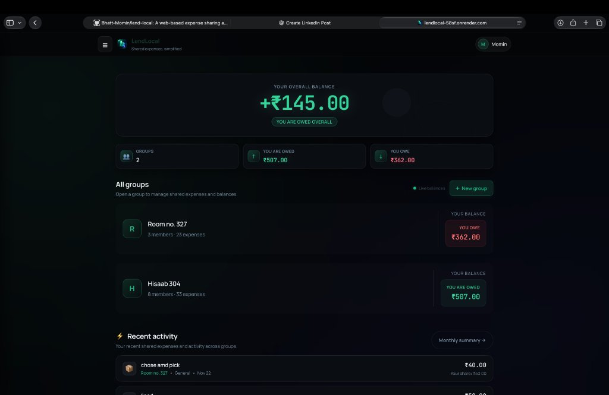
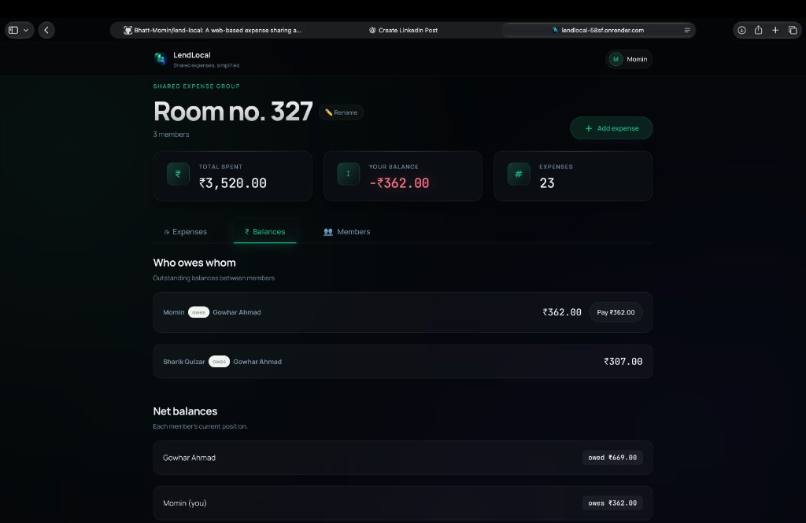
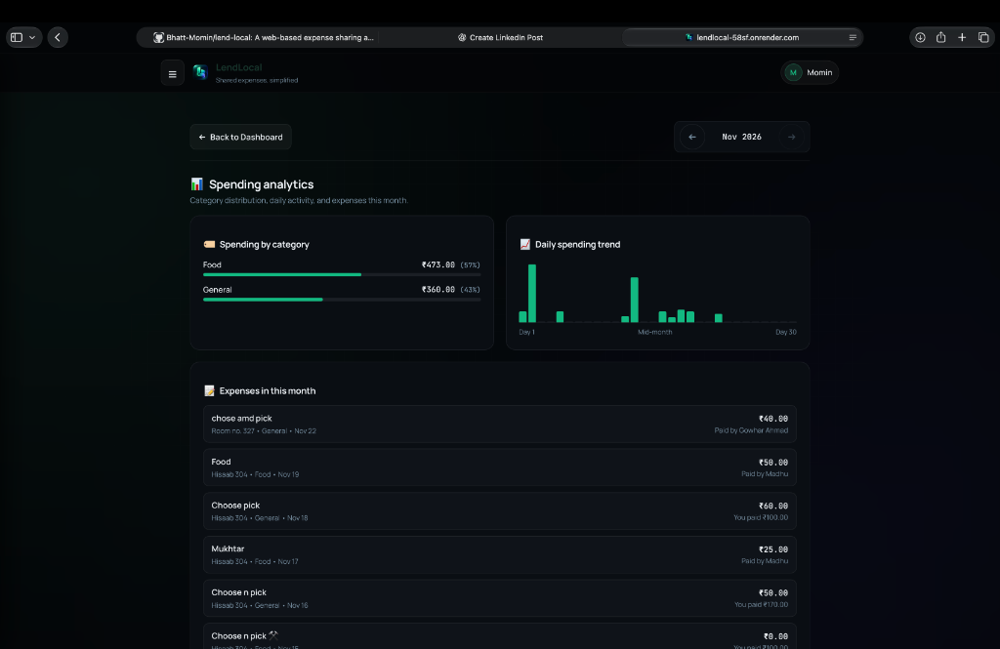
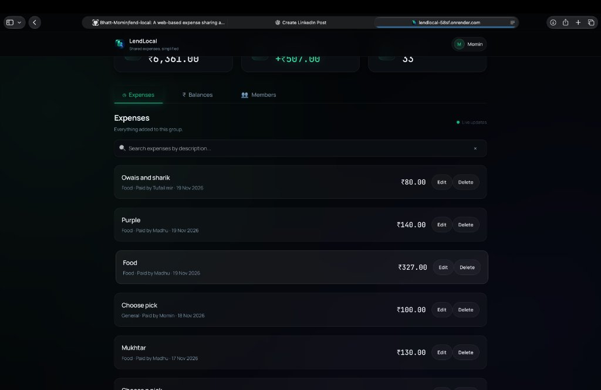
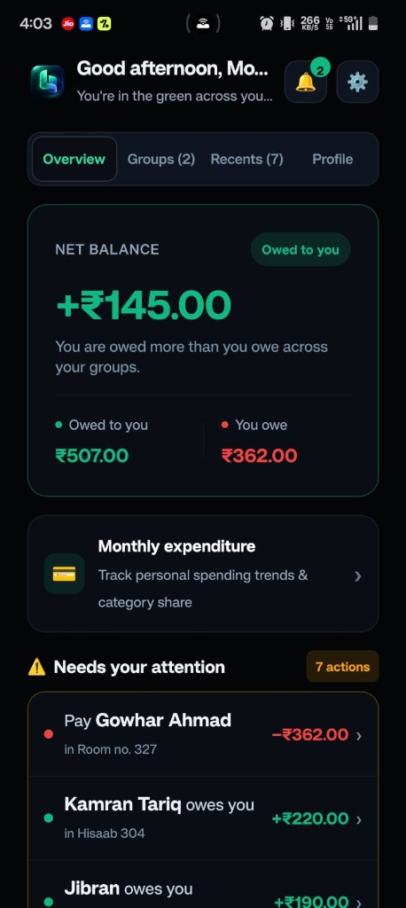
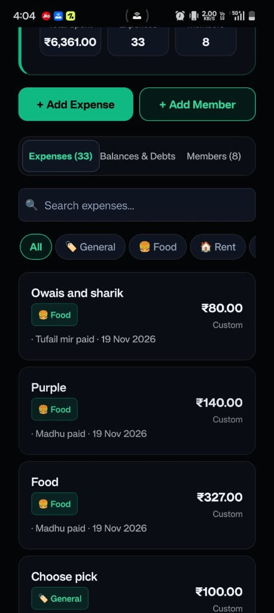
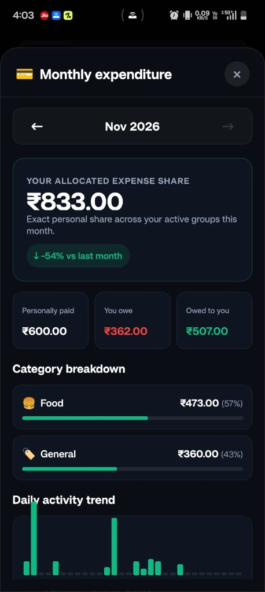
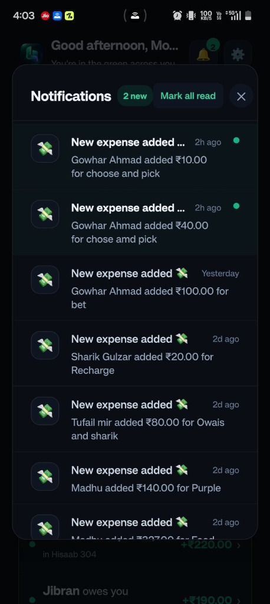

# LendLocal

<p align="center">
  <strong>Fast, fair, and frictionless shared expense management for roommates, friends, and groups.</strong>
</p>

<p align="center">
  <a href="https://lendlocal-58sf.onrender.com"></a>
  <a href="https://github.com/Bhatt-Momin/lend-local/releases/tag/v1.2.0"></a>
  
  
  
  
</p>

---

## 📌 Overview

**LendLocal** is a full-stack financial platform designed to track shared living expenses, simplify multi-party debts, and settle balances instantly. Whether splitting rent with roommates, dining out with friends, or managing group trips, LendLocal eliminates manual spreadsheets and awkward balance reconciliations.

Available as both a **responsive Progressive Web App (PWA)** and a **native Android application (Expo SDK 57 / React Native 0.86)** with seamless UPI integration and in-app automated updates.

- 🌐 **Live Web Application**: [https://lendlocal-58sf.onrender.com](https://lendlocal-58sf.onrender.com)
- 📦 **Latest Android Release (v1.2.0)**: [Download Standalone APK](https://github.com/Bhatt-Momin/lend-local/releases/tag/v1.2.0)
- 🐙 **GitHub Repository**: [https://github.com/Bhatt-Momin/lend-local](https://github.com/Bhatt-Momin/lend-local)

---

## 📸 Application Screenshots

### 💻 Web Application Experience

| Dashboard & Net Balances | Group Balances & Debt Matrix |
| :---: | :---: |
|  |  |
| **Real-time overall balance & group listings** | **"Who owes whom" pairwise debts & settlement triggers** |

| Spending Analytics | Expense Ledger & Itemization |
| :---: | :---: |
|  |  |
| **Category distribution & daily spending trends** | **Itemized expense history with search and category tags** |

---

### 📱 Native Android Experience

| Home Dashboard | Group Expenses & Filters | Monthly Breakdown | Push Notifications |
| :---: | :---: | :---: | :---: |
|  |  |  |  |
| **Net balance & action center** | **Expense list with category chips** | **Visual daily expense bars** | **Real-time FCM updates** |

---

## ✨ Core Features

### 📱 Native Android Capabilities
- **One-Tap UPI Payments**: Seamlessly initiates native Android payment intents for Google Pay, PhonePe, Paytm, and BHIM with auto-populated VPA and amounts.
- **In-App APK Updates**: Built-in update engine that checks the backend release manifest, downloads the APK with real-time byte progress, validates package SHA-256 checksums, and launches the native package installer.
- **Deep-Link Settlement**: Tap payment links or QR deep links (`lendlocal://`) to open directly into settlement modals.
- **Push Notifications (FCM)**: Multi-device push notification inbox for expense additions, debt reminders, and payment confirmations.

### 💰 Financial & Settlement Engine
- **Equal & Custom Splits**: Split bills equally across members or assign custom itemized amounts.
- **Pairwise Debt Simplification**: Automatically computes optimal "who owes whom" settlement paths to minimize total transactions.
- **Debt Reminders**: Scheduled notifications to gently nudge group members with outstanding balances.
- **Spending Analytics**: Monthly expense visualization and category breakdowns (Food, Rent, Utilities, General).

### 🔒 Security & Architecture
- **JWT & Session Protection**: Strict token lifecycle management with automated expiration handling and secure storage.
- **SMS Phone Verification**: International phone verification with 6-digit OTP codes for secure password recovery.
- **Cryptographic File Integrity**: SHA-256 package hashing via streaming Android `ContentResolver` to protect against corrupted or tampered updates.
- **Offline-Ready PWA**: Service worker caching and background sync for smooth browser usage.

---

## 🏗️ System Architecture

```text
                           ┌────────────────────────┐
                           │      Web Browser       │
                           │     (HTML5 / PWA)      │
                           └───────────┬────────────┘
                                       │ HTTPS / REST
                                       ▼
┌────────────────────────┐  REST   ┌────────────────────────┐  Mongoose  ┌────────────────────────┐
│   Android Mobile App   ├────────►│   Node.js / Express    ├───────────►│     MongoDB Atlas      │
│ (Expo / React Native)  │         │      Backend API       │            │   (Cloud Database)     │
└───────────┬────────────┘         └───────────┬────────────┘            └────────────────────────┘
            │                                  │
            │ Native Intents                   │ Firebase Admin SDK
            ▼                                  ▼
┌────────────────────────┐         ┌────────────────────────┐
│  UPI Apps (GPay, etc.) │         │ Firebase Cloud (FCM)   │
└────────────────────────┘         └────────────────────────┘
```

### Directory Structure

```text
lend-local/
├── backend/              # Node.js Express REST API
│   ├── config/           # Database & Firebase Admin initialization
│   ├── middleware/       # JWT auth, rate limiting & security headers
│   ├── models/           # Mongoose schemas (User, Group, Expense, Notification)
│   ├── routes/           # Auth, Groups, Expenses, Balances, Payments, Updates
│   └── services/         # Debt reminders, email dispatch, push notifications
│
├── frontend/             # Responsive Web & PWA
│   ├── css/              # Dark-mode fintech design system
│   ├── js/               # API clients, service worker, effects & PWA lifecycle
│   └── *.html            # Auth, Dashboard, and Group management pages
│
├── mobile/               # Native Android App (Expo SDK 57 / React Native)
│   ├── modules/          # Custom native Kotlin modules (ApkInstaller streaming SHA-256)
│   ├── src/app/          # Expo Router file-based navigation
│   ├── src/components/   # In-app update modal, payment modals, deep link handlers
│   └── src/services/     # Update service, secure store, API client
│
├── docs/                 # Documentation assets & screenshots
│   └── screenshots/      # High-res Web & Mobile interface captures
│
└── tests/                # Automated regression & integration test suites
```

---

## 🚀 Getting Started

### 1. Prerequisites
- **Node.js** >= 18.x
- **MongoDB** local instance or MongoDB Atlas URI
- **EAS CLI** (for mobile builds): `npm install -g eas-cli`

### 2. Backend Setup
```bash
cd backend
npm install
cp .env.example .env   # Configure PORT, MONGO_URI, JWT_SECRET, etc.
npm run dev
```

### 3. Frontend Setup
The frontend runs as static HTML/CSS/JS files and can be served directly via the backend or any static web server:
```bash
# Served automatically by the backend at http://localhost:5000
```

### 4. Mobile App Setup (Expo)
```bash
cd mobile
npm install
npx expo start
```
- Press `a` to run on an Android emulator or scan the QR code with the Expo Go app.

### 5. Build Standalone Android APK
```bash
cd mobile
npx eas-cli build --platform android --profile production
```

---

## 🧪 Testing & Verification

Run the complete regression test suite:
```bash
npm test
```

All three test suites execute sequentially and must exit with code 0:
- `test_inapp_update.js` — Stage 5: In-App Android Update System & Manifest Validation
- `test_m3_website_download.js` — Milestone 3: Website Download & Route Integration
- `test_stage2_stage3_fixes.js` — Stage 2 & 3 Audit Fixes & Regressions

---

## 📦 Distribution & Releases

- **Web App**: Hosted on [Render](https://lendlocal-58sf.onrender.com).
- **Android APK**: Downloadable directly from the Web App login page or via [GitHub Releases](https://github.com/Bhatt-Momin/lend-local/releases/tag/v1.2.0).
- **Checksum Verification**:
  ```text
  File: lendlocal.apk (v1.2.0)
  SHA-256: 70c95bfaf0f6b70043009fd5c4a9cc704ff671e7463d9020bb855b0baf5e18b9
  ```

---

## 📄 License

ISC License © 2026 Momin Nazir Bhat.
